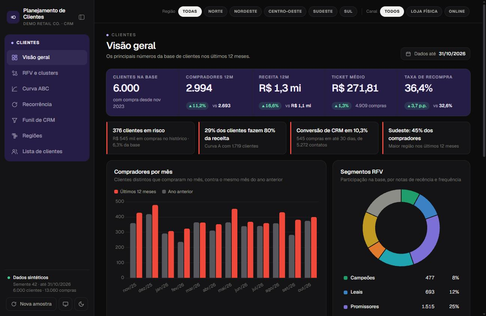

# Customer Planning · RFV dashboard (Demo Retail Co.)

**▶ [Demo ao vivo](https://viniboricuo.github.io/customer-planning-rfv/)** · [Modo TV](https://viniboricuo.github.io/customer-planning-rfv/tv.html) · RFV · k-means · curva ABC · safras · funil de CRM



**Em números:** ~6.000 clientes e ~13 mil compras em 36 meses · 7 segmentos RFV + k-means (k = 5) · 14 campanhas de CRM com atribuição de 30 dias · 27 UFs em 5 regiões

> **Projeto de portfólio. Marca, dados e código fictícios, gerados sinteticamente; não contém código, dados, fotos ou logos de nenhuma empresa.**

## English summary

A static, backend-free customer-planning (CRM) dashboard for a fictional retailer, **Demo Retail Co.** Everything runs in the
browser on synthetic data produced by a seeded generator, so the same seed always produces the same numbers.

- **Pages:** Overview · RFV & clusters · ABC curve · Recurrence · CRM funnel · Regions · Customer list (search + CSV export).
- **TV mode** (`tv.html`): full-screen dark view that rotates five screens with a progress bar, clock, pause, settings and a news ticker.
- **Analytics in plain JS:** RFV quintile scoring and segments, k-means (k = 5, k-means++), Pareto/ABC classes, repeat-purchase
  rate, purchase-interval histogram, acquisition cohorts and a five-step CRM funnel with 30-day attribution.
- **Stack:** HTML, CSS and vanilla JavaScript; Chart.js 4.4.1 (cdnjs) and the Geist font (Google Fonts). No build step.
- **Run:** double-click `index.html`, or publish the folder on GitHub Pages. UI language is Brazilian Portuguese.

## Português

Painel estático de planejamento de clientes (CRM) de um varejista fictício, a **Demo Retail Co.**. Não tem servidor: os dados
são gerados no navegador por um gerador com semente (o mesmo número de semente gera sempre os mesmos dados) e todos os cálculos
são feitos em JavaScript.

### Como rodar

- **Local:** abra `index.html` com dois cliques (funciona em `file://`). O modo TV é o `tv.html`, ou o ícone de TV no rodapé do menu.
- **GitHub Pages:** publique a pasta como está (Settings → Pages → branch e pasta raiz). Todos os caminhos são relativos.
- **Internet:** só para o Chart.js (cdnjs) e a fonte Geist (Google Fonts). Sem internet, o painel funciona e mostra um aviso no lugar dos gráficos.
- **Nova amostra:** o botão no rodapé do menu troca a semente e gera outra base. O modo TV aceita `?seed=`, `?tela=` (`geral`, `rfv`, `regioes`, `funil`, `abc`) e `?segundos=`.

### Páginas

| Página | O que mostra |
|---|---|
| Visão geral | Faixa de números (base, compradores, receita, ticket, recompra x ano anterior), destaques clicáveis, compradores por mês x ano anterior, segmentos RFV, receita e clientes novos por mês, cartões por região |
| RFV e clusters | Grade recência × frequência pintada pelo segmento, lista de segmentos, composição por nota V, detalhe do segmento com ação sugerida e maiores clientes; modo **k-means** com dispersão, tabela de clusters e perfil dos centróides |
| Curva ABC | Curva de Pareto em faixas de 2% dos clientes, classes A/B/C, ABC por segmento e por região, 20 maiores clientes |
| Recorrência | Taxa de recompra, intervalo entre compras, dias até a 2ª compra, compras por cliente e matriz de safras (coortes) |
| Funil de CRM | Base → contatados → engajados → convertidos (30 dias) → recompra, por canal, dias até a conversão e tabela de campanhas |
| Regiões | Mapa abstrato em grade (um quadrado por estado, sem geometria real) com compradores, evolução ou recompra; regiões e estados; ranking de lojas ordenável |
| Lista de clientes | Busca por ID ou nome, filtro por segmento, ordenação, paginação e exportação CSV (`;`, vírgula decimal, UTF-8 com BOM) |

Os chips do topo (região e canal) filtram todas as páginas. Tema claro/escuro (segue o sistema até ser trocado), menu recolhível.

### Como os números são calculados

**RFV (notas por quintis).** Para cada cliente com compra:
- **R (recência)** = dias desde a última compra até a data de referência, em quintis: nota 5 para os 20% mais recentes, 1 para os 20% mais antigos.
- **F (frequência)** = número de compras em faixas fixas (1, 2, 3, 4–5, 6+), porque quintis não funcionam com tantos empates em 1 compra.
- **V (valor)** = valor total comprado, em quintis (5 = os 20% que mais gastaram).

Os segmentos saem da grade R × F: **Campeões** (R≥4, F≥4), **Novos** (R≥4, F=1), **Leais** (R≥3, F≥3), **Promissores** (R≥3, demais),
**Em risco** (R≤2, F≥3), **Hibernando** (R=2, F≤2) e **Perdidos** (R=1, F≤2).

**Clusters (k-means).** k = 5 sobre log(1+recência), log(frequência) e log(valor), padronizados (z-score); inicialização
k-means++ com semente fixa, até 40 iterações. Cada cluster recebe o nome do segmento por notas mais comum entre os seus clientes
(casamento guloso, sem repetir nomes). A página mostra a concordância entre os dois métodos.

**Curva ABC.** Clientes ordenados do maior para o menor valor; **A** são os que somam os primeiros 80% da receita, **B** os próximos
até 95% e **C** os 5% finais. Também mostra quanto da receita vem do 1% e dos 20% que mais compram.

**Recorrência.** Taxa de recompra = compradores dos últimos 12 meses com compras em 2 ou mais datas ÷ compradores dos 12 meses
(comparada com os 12 meses anteriores, em p.p.). Histograma do intervalo entre compras consecutivas, mediana de dias até a 2ª
compra e safras: clientes adquiridos em cada um dos últimos 12 meses e a % que voltou a comprar em M1…M11.

**Funil de CRM.** Clientes únicos em cada etapa, nas campanhas dos últimos 12 meses: **Base** (clientes com compra) →
**Contatados** (receberam ao menos uma campanha) → **Engajados** (abriram, clicaram ou responderam) → **Convertidos** (compraram em
até 30 dias após um contato) → **Recompra** (compraram de novo depois da primeira compra convertida). A atribuição é por janela,
então inclui quem compraria de qualquer forma.

### Dados sintéticos (`js/data.js`)

- PRNG com semente (mulberry32); data de referência fixa em 31/10/2026 e 36 meses de compras.
- ~6.000 clientes com IDs `CLI-000001` e nomes inventados (primeiro nome + inicial), 5 regiões e 27 UFs com pesos diferentes,
  ~50 lojas fictícias (`Loja SP-01`…) e uma loja online.
- Frequência log-normal, ticket log-normal correlacionado com a frequência e alguns grandes compradores (cauda longa, perfil de
  Pareto), abandono por compra, sazonalidade mensal e histórico anterior à janela (base em regime, sem crescimento artificial).
- 14 campanhas de CRM (e-mail, WhatsApp, SMS, push) com públicos diferentes, eventos de engajamento e compras geradas pela conversão.

### Estrutura

```
index.html        painel (abas no menu lateral)
tv.html           modo TV
css/style.css     tema claro/escuro, menu, faixa de números, cartões, tabelas
css/tv.css        modo TV
js/data.js        gerador de dados sintéticos com semente
js/analytics.js   RFV, k-means, ABC, recorrência, funil, regiões e formatação pt-BR
js/map.js         mapa abstrato em grade (SVG)
js/app.js         rotas, filtros, tema e páginas do painel
js/tv.js          giro de telas do modo TV
```

### Aviso

Projeto de portfólio. Marca, dados e código fictícios, gerados sinteticamente; não contém código, dados, fotos ou logos de nenhuma empresa.
Qualquer semelhança de nomes, números ou lojas com casos reais é coincidência.

Licença: MIT (ver `LICENSE`).
